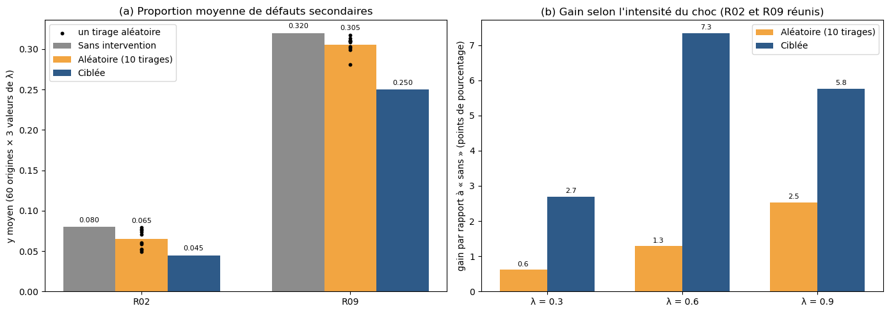

# Contagion dans les réseaux bancaires : simuler, prédire, protéger

Simulation de cascades de défauts dans des réseaux interbancaires, prédiction de leur ampleur par machine learning et évaluation d'une politique de recapitalisation ciblée, avec Python.

Hackathon Data Science & Risque de l'Université de Bordeaux (septembre-octobre 2026), réalisé en équipe avec Guillemette Cipriano et Andréa Saint Paul, dans le cadre du Master Ingénierie des Risques Économiques et Financiers – Economic Risk and Data Sciences.

## Question étudiée

À partir de la structure d'un réseau de dettes entre banques, peut-on prévoir l'ampleur d'une cascade de défauts, et proposer une intervention qui en réduit les conséquences ?



## Données

- **12 réseaux interbancaires fictifs** de 60 banques chacun, soit 720 banques et 2 134 dettes, fournis par le dépôt du cours.
- **Pour chaque banque,** son capital ; **pour chaque dette,** le débiteur, le créancier et le montant.
- **Répartition imposée :** 8 réseaux pour l'apprentissage, 2 pour la validation et 2 pour le test.

## Démarche

### 1. Décrire

- Contrôles de qualité des données : aucune anomalie détectée.
- Construction des graphes orientés pondérés avec NetworkX.
- Indicateurs par banque : degrés et poids entrants et sortants, fragilité (créances rapportées au capital).

### 2. Simuler

- **Cascade à seuil :** quand une banque fait défaut, chacun de ses créanciers perd une fraction λ de ce qu'elle lui doit. Un créancier fait défaut à son tour quand sa perte totale dépasse strictement son capital.
- **Validation :** le simulateur (`mon_simulateur.py`) passe les 9 tests de vérification du cours : exemple de référence, défauts simultanés, monotonie, absence de double comptage, etc.
- **Scénarios :** 2 160 scénarios, en prenant chaque banque comme origine du choc, dans chaque réseau, avec λ ∈ {0,3 ; 0,6 ; 0,9}.

### 3. Prédire

- **Cible :** la part de défauts secondaires de chaque scénario.
- **Variables :** uniquement des caractéristiques du réseau connues avant le choc, dont deux variables construites (`atteignables_2`, `pression_creanciers`).
- **Modèle :** forêt aléatoire (scikit-learn). La profondeur est choisie sur les réseaux de validation, puis l'échantillon de test est utilisé une seule fois.
- **Références :** médiane globale et médiane par valeur de λ.

### 4. Protéger

- **Budget :** 10 % du capital total, réparti entre 5 banques choisies avant le choc.
- **Choix de la règle :** 5 règles de ciblage sont comparées sur les 10 réseaux d'apprentissage et de validation. La règle retenue est ensuite figée avant le test.
- **Comparaison :** la règle ciblée est opposée à l'absence d'intervention et à 10 tirages aléatoires, sur les mêmes scénarios.
- **Prolongement :** effet d'un budget allant de 2,5 % à 30 % des capitaux.

## Résultats sur les réseaux de test

| Prédiction de l'ampleur de la cascade | Erreur absolue moyenne |
|---|---|
| **Forêt aléatoire** | **0,102** |
| Médiane par λ (référence) | 0,199 |

| Intervention (budget de 10 %) | Réduction des défauts secondaires |
|---|---|
| **Règle ciblée : fragilité × nombre de créanciers** | **5,3 points** |
| 5 banques tirées au hasard (moyenne de 10 tirages) | 1,5 point |

- **La forêt aléatoire divise l'erreur par deux.** Le gain vient du réseau contagieux R09. Sur R02, peu contagieux, la simple médiane reste meilleure.
- **Le ciblage fait trois fois mieux que le hasard,** et bat chacun des 10 tirages aléatoires.
- **Bien cibler compte plus que dépenser :** dans R09, une intervention ciblée avec 5 % des capitaux fait mieux qu'un renforcement au hasard avec 30 %.
- **Prédire n'est pas protéger :** la banque dont le défaut serait le plus contagieux n'est pas forcément celle qu'il faut renforcer. Il faut protéger les banques fragiles qui *transmettent* les pertes.

## Limites

- Les résultats reposent sur deux réseaux de test seulement, issus du même générateur que les autres.
- Le simulateur est un mécanisme pédagogique simplifié : pas de paiements partiels, pas de ventes d'actifs, pas de réaction des marchés. Les résultats ne sont pas des prévisions sur des banques réelles.

## Reproduire l'analyse

Les données et les fonctions d'aide appartiennent au dépôt du cours et ne sont pas copiées ici.

1. Télécharger le dépôt du cours :
   ```bash
   git clone https://github.com/marioveruetephd/hackathon-contagion-bancaire.git
   ```
2. Copier `Projet.ipynb` et `mon_simulateur.py` à la racine de ce dossier, à côté de `aides/` et `donnees/`.
3. Installer les dépendances : `pip install -r requirements.txt`.
4. Ouvrir `Projet.ipynb` dans Jupyter et lancer **Restart & Run All** (environ une minute).

**Graines aléatoires :**
- forêt aléatoire : `random_state = 100` ;
- interventions aléatoires : les 10 tirages officiels du cours (graines 0 à 9) ;
- disposition du graphe : `seed = 42`.

Les deux cellules interactives (`ipywidgets`) ne s'affichent pas sur GitHub : il faut exécuter le notebook pour les utiliser.

## Structure du dépôt

```
├── Projet.ipynb              # Notebook complet : données, simulation, machine learning, interventions
├── mon_simulateur.py         # Construction du graphe et simulateur de cascade
├── requirements.txt          # Dépendances Python
├── resultats/                # Figures produites par le notebook
└── presentation/             # Diapositives de la soutenance (PDF)
```

## Outils

Python, pandas, NumPy, NetworkX, scikit-learn, Matplotlib, ipywidgets.

## Ressources utilisées

- Le sujet, les données et les fonctions d'aide du dépôt du cours, encadré par Dr. Mario Veruete.
- La documentation de NetworkX et de scikit-learn.
- Claude (Anthropic), utilisé comme assistant pour le code.

## Auteurs

- **Jules Marin** – [LinkedIn](https://www.linkedin.com/in/jules-marin-64611035a/)
- **Guillemette Cipriano**
- **Andréa Saint Paul**
